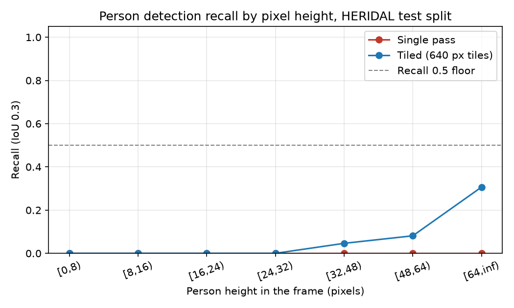
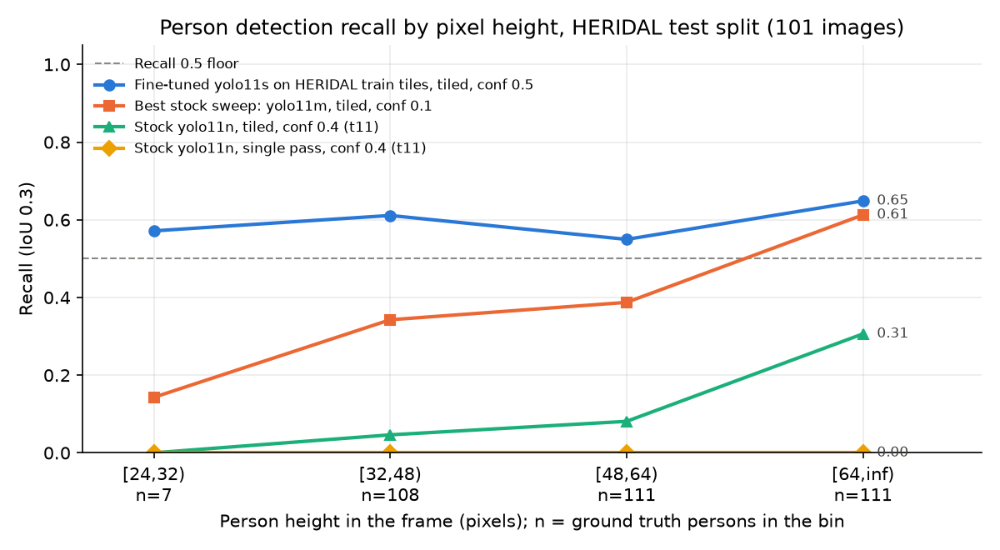

# FlightRisk pitch deck

Open-source aerial search software for Utah's volunteer search and rescue teams, pitched for the Nucleus × Startup State Hard Tech bounty. Five slides. Every line with a figure links its source or is marked ASSUMPTION. The spoken version is [docs/demo-script.md](demo-script.md).

## Slide 1 — Problem

- Utah's county search and rescue teams are volunteers. Salt Lake County's team has about 40 of them (https://saltlakecounty.gov/sheriff/law-enforcement/search--rescue-team).
- On foot, searching is slow: one ground team needs about 58 hours to sweep one square mile (planner output 57.555 h, from a 30 m sweep width and a walking speed of 1.5 km/h that is an ASSUMPTION; https://github.com/KurtLehnardt/flightRisk/blob/main/docs/fleet-scaling.md).
- A drone covers ground faster, but from search altitude a person is only a few dozen pixels tall, and an off-the-shelf detector does not see them.
- Measured: stock YOLO11n, run once on the full frame, found 0/337 people in the HERIDAL search-and-rescue test images (https://github.com/KurtLehnardt/flightRisk/blob/main/docs/altitude-benchmark.md).
- The smallest person the detector can find sets the flight altitude, and the altitude sets lane spacing and the time to cover ground. That number has to be measured, not guessed.

## Slide 2 — Solution: the hard tech

**What's the hard tech?** Two engineering problems, both built this week.

**1. Detecting a person a few dozen pixels tall from altitude.** Measured on the public HERIDAL dataset: 101 test images at 4000x3000, 337 people, shot from 40 to 65 m (https://github.com/KurtLehnardt/flightRisk/blob/main/docs/altitude-benchmark.md).

| Detector on the HERIDAL test split | Overall recall | Overall precision | `min_person_px` | Source |
|---|---|---|---|---|
| Stock YOLO11n, single pass | 0.000 (0/337) | 0.000 | none | [benchmark](https://github.com/KurtLehnardt/flightRisk/blob/main/docs/altitude-benchmark.md) |
| Stock YOLO11n, tiled (640 px tiles) | 0.142 (48/337) | 0.696 | none | [benchmark](https://github.com/KurtLehnardt/flightRisk/blob/main/docs/altitude-benchmark.md) |
| YOLO11s fine-tuned on HERIDAL train tiles, tiled | 0.602 (203/337) | 0.832 | 24 | [benchmark](https://github.com/KurtLehnardt/flightRisk/blob/main/docs/altitude-benchmark.md) |

- The 24 px threshold rests on only 7 people, so it is weak. 32 px is the solid value: 108 people, recall 0.611, 95% interval 0.52 to 0.70 (https://github.com/KurtLehnardt/flightRisk/blob/main/docs/altitude-benchmark.md).
- Recall plateaus near 0.6 at every height, so about 4 in 10 people are still missed on a single pass (https://github.com/KurtLehnardt/flightRisk/blob/main/docs/altitude-benchmark.md).

**From threshold to flight plan.** The coverage planner turns a camera model and `min_person_px` into altitude, lane spacing and hours per square mile. At 32 px an open-source quad with a 4K gimbal camera (ASSUMPTION: the planner assumes a person spans 1.7 m straight down, so the altitude and hours may be optimistic) flies at 96.8 m and sweeps one square mile in 0.398 h (its speed and endurance are ASSUMPTION). A Tello is INFEASIBLE for a square mile: its published limits are 30 m height and 100 m range (https://github.com/KurtLehnardt/flightRisk/blob/main/docs/altitude-benchmark.md).

**2. A synchronized, fault-tolerant drone fleet.** One ground coordinator splits the area into zones, gives each drone its own altitude slot, synchronizes clocks NTP-style over WebSocket, starts every drone at one scheduled time, merges detections onto one map, re-tasks a lost drone's lanes to the survivors and can land every drone at once. Each drone's edge process enforces its own geofence, battery limits and link-loss landing.

## Slide 3 — Built this week

**Show it working.**

- Before kickoff (commit `798f21a`, tag `hackathon/kickoff`) the repository had a single-drone pipeline: detection, re-identification, tracking, MAVLink control, an edge/ground split and 676 tests (https://github.com/KurtLehnardt/flightRisk/commit/798f21a).
- Built this week, with every new and changed path listed in `docs/built-this-week.md` (https://github.com/KurtLehnardt/flightRisk/blob/main/docs/built-this-week.md):
  - the altitude benchmark, tiled inference and the HERIDAL fine-tune, taking recall from 0.000 to 0.142 to 0.602 (https://github.com/KurtLehnardt/flightRisk/blob/main/docs/altitude-benchmark.md);
  - the coverage planner, with each platform's altitude and range limits;
  - the fleet: coordinator, clock sync, lane executor, safety envelope, LAND ALL, the dashboard's per-drone status cards and merged map, and two network paths for two laptops (https://github.com/KurtLehnardt/flightRisk/blob/main/docs/fleet-setup.md);
  - an N-drone launcher: four fake drones against one ground station; killing one re-tasked its lanes to the other three 0.7 s later (https://github.com/KurtLehnardt/flightRisk/blob/main/docs/fleet-scaling.md).
- Live in this slot: two Tello EDUs fly a coordinated split search. Plan shows two zones at two altitude slots, Start lifts both drones at one scheduled time, detections from both land on one map, and landing one drone hands its unflown lanes to the other.
- Honest status: the automated tests and the four-drone run use fake drones. The two-Tello flight is the live demo, with a recorded video and the fake fleet as fallbacks (https://github.com/KurtLehnardt/flightRisk/blob/main/docs/demo-script.md).

## Slide 4 — Why Utah

**Who needs it?** The user we are building for is the Salt Lake County Sheriff's Search and Rescue Team, about 40 volunteers: a target customer (ASSUMPTION: no contact yet). Source: https://saltlakecounty.gov/sheriff/law-enforcement/search--rescue-team

- Demand: Summit County runs a search and rescue mission about every three days, and only 7% of them involve locals (https://townlift.com/2025/06/only-7-of-search-and-rescue-missions-involve-locals-summit-county-backs-bill-to-ease-burden-on-taxpayers).
- Demand: Washington County search and rescue made 117 rescues in 2024 (https://fox13now.com/news/local-news/southern-utah/washington-county-search-and-rescue-saved-more-than-100-people-in-2024).
- Funding channel: Utah already funds county search and rescue through the USARA card program (https://secure.utah.gov/rescue/cards.html).
- A path to a Utah company (ASSUMPTION): free open-source software for county teams first, then hardware integration with in-state drone makers such as Teal Drones in Salt Lake City (https://stateaviationjournal.com/index.php/state-news/utah/red-cat-subsidiary-teal-drones-opens-u-s-manufacturing-facility). There is no relationship with Teal today.
- Honest limit: dense tree canopy defeats RGB and most thermal imaging, so the fit is open terrain (desert, canyon, meadow, snow), not forest.
- Privacy: faces are not resolvable at search altitude, so FlightRisk is appearance-only by design, on the edge too, with no face embeddings sent. Person crops and ReID appearance embeddings go from each edge to the ground station over a token-authenticated link, and no bystander imagery is saved to disk by default (https://github.com/KurtLehnardt/flightRisk/blob/main/docs/privacy-design.md).

## Slide 5 — The ask

**What does $10,000 unlock?** The next concrete milestone, itemised in the roadmap appendix (https://github.com/KurtLehnardt/flightRisk/blob/main/docs/roadmap-budget.md).

- **$5,000 stands alone.** It funds an open-source quad and a Part 107 remote pilot for the first real flight, which checks the measured `min_person_px` (24 px optimistic, 32 px solid) at the planned altitude. Budget $4,765; prices are ASSUMPTION (https://github.com/KurtLehnardt/flightRisk/blob/main/docs/roadmap-budget.md).
- **$10,000 adds onboard compute and a fleet.** A SIYI A8 mini class gimbal camera (about $230 to $285, https://www.readymaderc.com/products/details/87067-siyi-a8-mini-4k-8mp-ultra-hd-6x-digital-zoom-gimbal-camera), a Jetson Orin Nano Super so the edge process runs on board ($249, https://www.phoronix.com/news/NVIDIA-Jetson-Orin-Nano-Super) and a second airframe. Budget $9,514; the other prices are ASSUMPTION.
- **Why that flight matters.** At 32 px the planner flies that quad at 96.8 m and sweeps one square mile in 0.398 h with one drone or 0.199 h with two, against 57.555 h for one ground team. Speeds and the 1.7 m person size are ASSUMPTION, and these are hours to sweep once at about 0.6 recall, not hours to find everyone (https://github.com/KurtLehnardt/flightRisk/blob/main/docs/fleet-scaling.md).
- **Timeline.** Weeks 1 to 2: buy the quad and book the pilot. Weeks 3 to 4: first validation flight. Weeks 5 to 8: gimbal and Jetson. Weeks 9 to 12: a two-aircraft flight and a demo for a SAR team (https://github.com/KurtLehnardt/flightRisk/blob/main/docs/one-page-plan.md).
- **After the hackathon.** Solo team (ASSUMPTION), building on weekends for the next 90 days and publishing every benchmark result in the repository (https://github.com/KurtLehnardt/flightRisk/blob/main/docs/one-page-plan.md).
- **Open source.** FlightRisk is GPL-3.0-or-later. The Ultralytics YOLO detector is AGPL-3.0 and can be swapped for an Apache-2.0 detector (https://github.com/KurtLehnardt/flightRisk/blob/main/docs/licensing.md).
